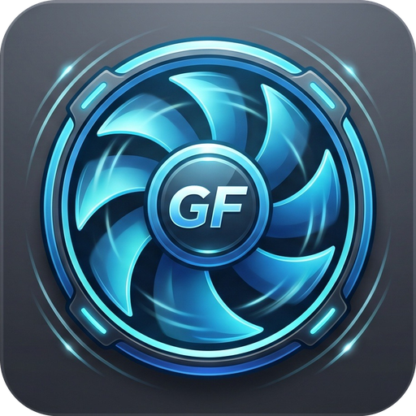
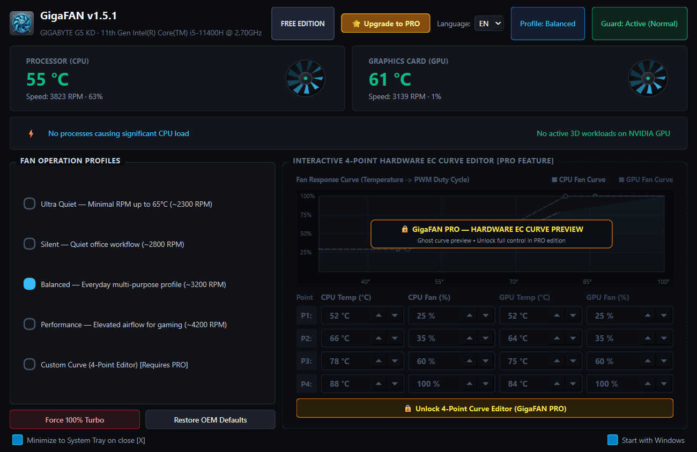

  

  # GigaFAN & GigaFAN PRO

  **Ultra-lightweight, hardware-level fan controller designed specifically for gaming laptops.**  
  *Silence the annoying fan whistle during daily tasks, take full control with custom curves, and stay cool under gaming loads.*

  [-blue?style=for-the-badge&logo=windows)](https://github.com/MgrMRCN/GigaFAN)
  
  
  

---

## 📸 Preview

  

---

## ⚡ The Problem GigaFAN Solves

Many modern gaming laptops (such as **Gigabyte G5 / G7**, **Clevo barebones**, **Dream Machines**, **Hasee**, **XMG**, and other **Insyde DCHU / Clevo EC** platforms) suffer from frustrating factory fan curve behavior:
- 🌀 **Annoying fan whistling and pulsing**: Fans ramp up and down aggressively even during light browsing, watching YouTube, or working in office apps.
- 🐌 **Bloated OEM control centers**: Heavy proprietary background services consume significant CPU and RAM, frequently conflict with sleep/wake cycles, or reset custom fan curves.
- 🎛️ **Lack of curve customization**: Factory presets rarely offer fine-grained temperature-to-RPM stepped curves.

**GigaFAN** communicates directly with your laptop's Embedded Controller (EC) via low-level hardware memory registers, providing **whisper-quiet operation, rock-solid stability, and sub-10 MB memory usage**.

---

## 🌟 Key Features

| Feature | Free Edition | PRO Edition ($5.99) |
| :--- | :---: | :---: |
| **Real-time CPU & GPU Thermal Monitoring** | ✅ | ✅ |
| **RPM Speed Reading & Instant Gauge** | ✅ | ✅ |
| **Ultra Quiet Profile (Fixed 1900 RPM)** | ✅ | ✅ |
| **Quiet Office Profile (Fixed 2300 RPM)** | ✅ | ✅ |
| **Balanced Profile (Stepped 2600 RPM)** | ✅ | ✅ |
| **Performance Profile (3400 RPM)** | ✅ | ✅ |
| **Interactive 4-Point Hardware EC Curve Editor** | ❌ | ✅ |
| **Custom Curve Stepping** (40°C, 55°C, 70°C, 85°C) | ❌ | ✅ |
| **Persistent Offline Hardware EEPROM Curve Flashing** | ❌ | ✅ |
| **Dual GPU Fan Synchronization Mode** | ❌ | ✅ |
| **Priority Support & Lifetime License** | ❌ | ✅ |

---

## 🚀 Getting Started

### Requirements
- **OS**: Windows 10 or Windows 11 (64-bit)
- **Supported Hardware**: Gaming laptops based on Clevo / Insyde DCHU Embedded Controllers (Gigabyte G5/G7 KD, KE, KF, MF, GE, Clevo NH5x/NP5x, Dream Machines, etc.)
- **Permissions**: Administrator privileges (required for direct EC hardware register communication).

### How to Install
1. Head over to our [Gumroad Store](https://marcianek.gumroad.com/l/yaxxgc) to download the setup package.
2. Run `GigaFAN_Setup.exe` and follow the on-screen installer instructions.
3. Launch GigaFAN from the desktop or start menu.
4. Enjoy quiet computing immediately with one of the built-in quick presets!

---

## 🔑 Upgrade to PRO

Unlock the full potential of your cooling system with custom hardware curves:

1. Purchase a lifetime license key on [Gumroad ($5.99)](https://marcianek.gumroad.com/l/yaxxgc).
2. Open GigaFAN, click **⭐ Upgrade to PRO** in the top bar.
3. Enter your license key (`GFPRO-XXXX-XXXX-XXXX-XXXX` or your Gumroad License Key) and click **Aktywuj**.
4. The key is verified once and signed with an offline digital signature — works seamlessly 100% offline from that point forward!

---

## 🛡️ Safety & Reliability

- **No Registry or Driver Pollution**: GigaFAN does not install invasive background telemetry services.
- **Fail-Safe Monitoring**: Thermal safety watchdogs prevent dangerous fan stops under high temperatures.
- **Clean Uninstaller**: Easily remove GigaFAN at any time through Windows Settings / Control Panel.

---

## 📬 Support & Community

- **AlternativeTo**: [Check GigaFAN on AlternativeTo](https://alternativeto.net/software/gigafan/about/)
- **Author**: MRCN
- **Issues & Feedback**: Open an issue on this repository or reach out via your Gumroad receipt.
